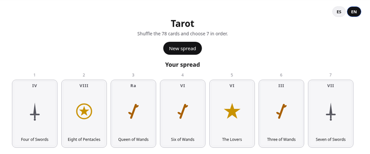
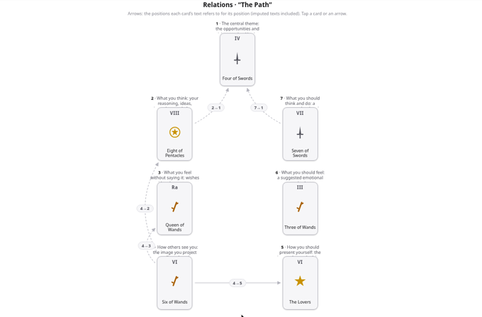

# Tarot «El Camino» / “The Path” Tarot

**[Español](#español) · [English](#english)**

App en vivo / Live app: **https://tarot-el-camino.eloogia.workers.dev/**

---

## Español

App de tarot bilingüe (español / inglés) que baraja las 78 cartas del tarot Rider-Waite, deja escoger 7 en la tirada «El Camino» y muestra el significado de cada carta según su posición, con las relaciones entre posiciones.

Todos los textos de las cartas son de redacción propia. Cada carta incluye, además, una sección de I Ching que profundiza en su hexagrama y una de mitología griega con el mito que mejor le corresponde.

### Funciones de la app

- Selector de idioma ES / EN visible; la elección se recuerda en el navegador y, la primera vez, se toma del idioma del sistema.
- Barajado aleatorio (Fisher-Yates) de las 78 cartas, mostradas boca abajo en abanico.
- Revelado automático al escoger la séptima carta.
- Vista de relaciones con flechas entre posiciones, tomadas del texto de cada carta.
- Números de posición clicables que abren las dos hojas lado a lado.
- Modo claro y oscuro.

### Cómo está hecha

- Una página estática (el front-end) que baraja y muestra las cartas.
- Un pequeño servidor en Cloudflare Workers que guarda los textos. Cuando escoges la séptima carta, la página le pide solo el significado de esas 7 cartas, en el idioma elegido y para la posición en que cayó cada una.
- El mazo completo no se publica: ni en la página ni en este repositorio. Por eso la app necesita conexión a internet.

### La tirada «El Camino»

| Posición | Significado |
|---|---|
| 1 | El tema central: las oportunidades y los riesgos que encierra la pregunta. |
| 2 | Lo que piensas: tus razonamientos, ideas, intenciones y planes, lo que llevas «en la cabeza». Tu conducta racional. |
| 3 | Lo que sientes sin decirlo: deseos y anhelos que llevas «en el corazón», tus esperanzas y tus miedos. Tu conducta emocional. |
| 4 | Cómo te ven: la imagen que das hacia fuera y, a veces, tu fachada. |
| 5 | Cómo conviene que te muestres: la imagen que te aconseja dar la carta. |
| 6 | Qué te conviene sentir: propuesta de actitud emocional. |
| 7 | Qué te conviene pensar y hacer: propuesta de conducta racional. |

### Nota

Algunas cartas (30, 31, 60, 62, 73 y 74) tienen partes escritas como redacción complementaria; están marcadas como texto imputado.

### Derechos

Los textos de las cartas son de redacción propia. Todos los derechos reservados: no se permite copiarlos, redistribuirlos ni reutilizarlos sin permiso del autor.

---

## English

A bilingual (Spanish / English) tarot app that shuffles the 78 cards of the Rider-Waite tarot, lets you choose 7 for “The Path” (El Camino) spread, and shows what each card means in its position, together with the relations between positions.

All card texts are original writing. Each card also has an I Ching section that explores its hexagram and a Greek mythology section with the myth that fits it best.

### App features

- A visible ES / EN language toggle; your choice is remembered in the browser and, the first time, follows your system language.
- Random (Fisher-Yates) shuffle of the 78 cards, shown face down in a fan.
- Automatic reveal when you choose the seventh card.
- A relations view with arrows between positions, taken from each card’s text.
- Clickable position numbers that open both sheets side by side.
- Light and dark mode.

### How it is built

- A static page (the front-end) that shuffles and shows the cards.
- A small Cloudflare Workers server that keeps the texts. When you choose the seventh card, the page asks it only for the meaning of those 7 cards, in the chosen language and for the position each one landed in.
- The full deck is not published: not in the page and not in this repository. That is why the app needs an internet connection.

### “The Path” spread

| Position | Meaning |
|---|---|
| 1 | The central theme: the opportunities and risks contained in the question. |
| 2 | What you think: your reasoning, ideas, intentions and plans, what you carry “in your head”. Your rational behaviour. |
| 3 | What you feel without saying it: wishes and longings you carry “in your heart”, your hopes and fears. Your emotional behaviour. |
| 4 | How others see you: the image you project outwardly and, at times, your façade. |
| 5 | How you should present yourself: the image the card advises you to give. |
| 6 | What you should feel: a suggested emotional attitude. |
| 7 | What you should think and do: a suggested rational course of action. |

### Note

Some cards (30, 31, 60, 62, 73 and 74) have parts written as supplementary text; they are marked as imputed text.

### Rights

The card texts are original writing. All rights reserved: they may not be copied, redistributed or reused without the author’s permission.

---

Hecho con apoyo de asistentes de IA (Grok Bot). / Made with the help of AI assistants (Grok Bot).
